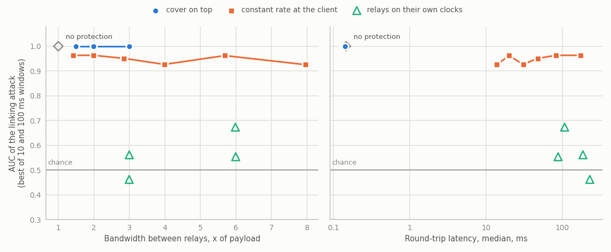
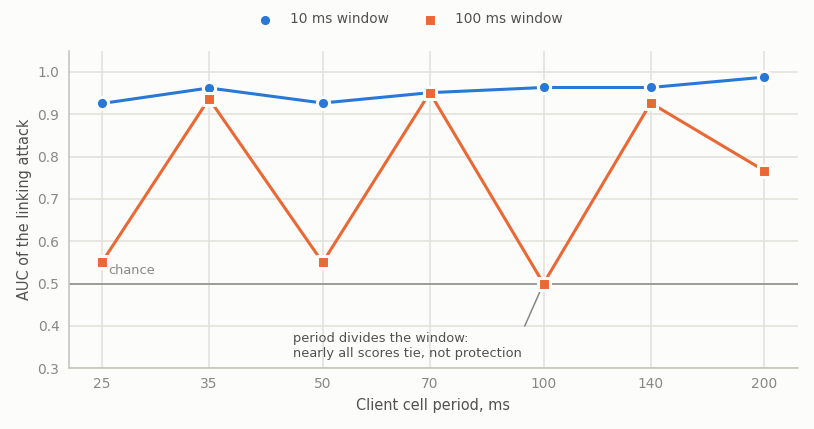

<p align="center"><picture><source media="(prefers-color-scheme: dark)" srcset="docs/img/mark-dark.gif"></picture></p>

<h1 align="center">jimichi</h1>

<p align="center">
  Confidential messaging that hides who talks to whom, and the measurements of what that
  protection is worth.
  <br>
  <a href="https://jimichi.org">jimichi.org</a> · <a href="#results">Results</a> · <a href="#documentation">Docs</a> · English | <a href="README.ru.md">Русский</a>
</p>

<p align="center">
  <a href="https://github.com/jimichi-org/jimichi/actions/workflows/ci.yml"></a>
  <a href="https://github.com/jimichi-org/jimichi/releases/latest"></a>
  <a href="https://scorecard.dev/viewer/?uri=github.com/jimichi-org/jimichi"></a>
  <a href="https://doi.org/10.5281/zenodo.23001699"></a>
</p>

- **A chain of three relays.** Messages travel under nested encryption through a chain the client draws at random from the nodes it lists; every hop strips exactly one layer and sees only its neighbours on the wire.
- **A conversation through a mailbox.** Two clients in `-peer` mode talk through a mailbox on the last node of their chains, under an end-to-end layer (a KK handshake and a hash ratchet over the same CryptoProvider); the mailbox holds only records of a constant size that it cannot read.
- **The question.** Protecting content is the easy part. What this work measures is the harder question: how much an observer who sees only timings and volumes can still learn, and what it costs to take that away. The repository therefore contains both the system and the attack against it.

## Status

| Part | Today | Planned |
|---|---|---|
| Keys | session keys are ephemeral, held in mlocked buffers outside the Go heap and zeroed after use; only these buffers are locked against swap; a node writes nothing to disk itself; copies the crypto libraries keep on the heap are not covered ([LIMITATIONS](docs/en/LIMITATIONS.md)) | locking all process memory ([#36](https://github.com/jimichi-org/jimichi/issues/36)) |
| Cells | every cell is the same size: a message that fits in one cell does not show its length on the wire, a longer one is refused with an error and not sent | fragmentation and size classes ([#68](https://github.com/jimichi-org/jimichi/issues/68)) |
| Nodes | a CA that exists only for the run certifies every relay; the client takes node keys only from bundles verified against the trust anchor; a relay extends circuits only to the certified nodes of its roster, over authenticated links (with `-auth`, the default); a node can serve each of the others its own onion key and so, as exit, learn the entry ([LIMITATIONS](docs/en/LIMITATIONS.md)) | authenticating the initiator on links between nodes ([#56](https://github.com/jimichi-org/jimichi/issues/56)), hiding the suite and role in the first handshake flight ([#57](https://github.com/jimichi-org/jimichi/issues/57)) |
| Conversation | two `-peer` clients through a mailbox on the last relay; offline deniable authentication, shown by forging a conversation with `cmd/lab -set deny`; the mailbox links the two circuits of a pair through their queues ([THREAT_MODEL](docs/en/THREAT_MODEL.md)) | measuring the topology of a conversation ([#47](https://github.com/jimichi-org/jimichi/issues/47)), queues without a lasting identifier and circuits per contact ([#84](https://github.com/jimichi-org/jimichi/issues/84), [#96](https://github.com/jimichi-org/jimichi/issues/96)) |
| Client container | `vault`: a file of a constant size with one or two volumes under passwords of their own; `jimichi vault init`, `jimichi vault show`; the file and one password hide a second volume only when its password was generated, and under coercion that volume is a cover story, not immunity ([THREAT_MODEL](docs/en/THREAT_MODEL.md)) | the `-peer` client with `-vault`, and the measurement of the container ([#20](https://github.com/jimichi-org/jimichi/issues/20)) |

## Results

A passive observer sees only when frames cross the entry link and the last link between relays. It
counts frames per time window for every flow and correlates every entry flow with every exit flow.
The window is the observer's choice, so both 10 ms and 100 ms are scored and the figure takes the
better one for the observer. Chance is AUC 0.5 and top-1 10%.

| Set | What varies | Revision | Flows | Relays | Runs per point | Windows |
|---|---|---|---|---|---|---|
| main | `none`, cover on top (`add-*`), a constant rate at the client (`fixed-*`) | 2078098 | 10 | 3 | 5 x 30 s | 10 ms, 100 ms |
| rates | `none`, a constant rate at the client by period (`fixed-*`) | 2078098 | 10 | 3 | 5 x 30 s | 10 ms, 100 ms |
| paced | `none`, relays on their own clocks (`relay-*`), both (`both-*`), the client alone (`fixed-*`) | 2078098 | 10 | 3 | 5 x 30 s | 10 ms, 100 ms |
| paths | the choice of a chain of 3 among 5 nodes, 1 or 2 of them rogue | 2078098 | - | 3 | 100000 draws each | - |

Suite c25519, base seed 1. Each client starts its schedule at a random phase; every AUC, top-1, bandwidth and round trip is the median across the runs of its configuration. As a consistency check between the sets, the paced set repeats the client-only runs: its medians at a 10 ms window (AUC 0.922 at 70 ms and 0.946 at 35 ms) lie within the run-to-run range of the rates set (0.890-0.965 and 0.907-0.984).

<picture>
  <source media="(prefers-color-scheme: dark)" srcset="docs/img/tradeoff-en-dark.png">
  
</picture>

| Set | Protection | Bandwidth between relays | Median round trip | AUC, 10 ms | AUC, 100 ms | Top-1, 10 ms |
|---|---|---|---|---|---|---|
| main | none | x1.00 | 0.146 ms | 1.000 | 1.000 | 100% |
| main | cover on top, +2x | x2.99 | 0.131 ms | 1.000 | 1.000 | 100% |
| rates | constant rate at the client, 70 ms | x2.85 | 48 ms | 0.951 | 0.951 | 70% |
| rates | constant rate at the client, 35 ms | x5.69 | 20 ms | 0.962 | 0.937 | 70% |
| paced | relays on their own clocks, 66.5 ms | x3.00 | 187 ms | 0.562 | 0.463 | 5% |
| paced | relays on their own clocks, 33.25 ms | x6.00 | 88 ms | 0.554 | 0.487 | 15% |
| paced | both, client 70 ms, relays 66.5 ms | x3.00 | 230 ms | 0.462 | 0.442 | 3% |
| paced | both, client 35 ms, relays 33.25 ms | x5.99 | 108 ms | 0.673 | 0.472 | 20% |

- Cover on top of real messages (main, `add-0.5x` to `add-2x`, both windows) does not help at all: even at x2.99 bandwidth between relays, AUC is 1.000 and top-1 100% in every run, so every flow is linked.
- A constant rate at the client (rates, `fixed-25ms` to `fixed-200ms`) does not stop the linking either: each client ticks with its own phase, the relays forward each cell immediately, and at a 10 ms window the AUC medians lie between 0.93 and 0.99 at every period.
  - At 100 ms the AUC falls to 0.50-0.55 only where the period divides the window (`fixed-25ms`, `fixed-50ms`, `fixed-100ms`) and stays at 0.77-0.95 elsewhere: with a dividing period nearly all scores tie, which says nothing about protection.

<picture>
  <source media="(prefers-color-scheme: dark)" srcset="docs/img/window-en-dark.png">
  
</picture>

- Relays sending on their own clocks (paced, `relay-*` and `both-*`, both windows): the AUC medians of this attack, which counts cells only, lie between 0.44 and 0.67, against 0.94-1.00 in the other rows, but these runs cannot show that it is at chance: four of the eight medians lie outside 0.45-0.55, and such a claim needs an equivalence interval inside that band, with the quantity and margin fixed before the series, which five runs cannot give.
  - The 95% interval of a single run includes 0.5 in 33 of 40 cases (of the other seven, three lie above and four below). Five runs of ten flows cannot tell a small remaining leak from none; the full series is to settle it.
  - The price is a constant stream on every link a relay sends on and about 2.7 to 2.8 node periods added to a round trip (187 ms at 66.5 ms, 88 ms at 33.25 ms). In `both-*` the relay period is 5% shorter than the client's, so a missed tick is caught up; `relay-*` uses the same relay periods with a client that sends at once.
- The choice of the chain (paths, 3 of 5 nodes, 100000 draws each): for a client without `-peer` drawing one chain from full mirrors, with one rogue node 0.599 of the chains include it (0.600 by the model); with two, 0.900 include at least one (0.900) and 0.100 have both entry and exit rogue (0.100), each within one standard error of the model value. A rogue entry that leaves out a node, the pinned exit of a `-peer` client and its rebuilds change these shares ([EXPERIMENT](docs/en/EXPERIMENT.md), block 3; [LIMITATIONS](docs/en/LIMITATIONS.md)).

### Bounds of these numbers

- One process on loopback, not the kind testbed below: no network delay, no certificates, onion key rotation or per-address limits, and anonymous links between relays; network emulation is planned ([#46](https://github.com/jimichi-org/jimichi/issues/46)).
- Echo topology: the last relay echoes every message, so the conversation of two clients through a mailbox is not in these numbers ([#47](https://github.com/jimichi-org/jimichi/issues/47)).
- 5 runs per point: no difference is claimed as significant; the full series of thirty runs per point is still to come ([#23](https://github.com/jimichi-org/jimichi/issues/23)).
- The attack is the baseline one: it counts cells only and ranks pairs of flows by Pearson correlation of the counts per window, on the forward direction only and with no time shift; the moments the connections of a circuit open and close match along the chain and are not part of it yet ([#43](https://github.com/jimichi-org/jimichi/issues/43)), and stronger attacks are planned ([#67](https://github.com/jimichi-org/jimichi/issues/67), [#116](https://github.com/jimichi-org/jimichi/issues/116)).
- The observer watches two links and does not model the entry node, which sees the client's cells directly; whether a constant client rate hides from it the moments the client sends is not measured ([#119](https://github.com/jimichi-org/jimichi/issues/119)).
- The round trip without protection or with cover only is below a millisecond and differs between sets by about 0.01 ms (0.14 to 0.15 ms without protection), so its last digits carry no meaning.
- Series are run with the kind cluster stopped and no build on the host; every `correlation-*` row records the load inside the VM the lab runs in, the seeds and the code revision, and every `paths-*` row the seed and the revision. The seeds fix the client schedules, not the run: in the paced set, run twice with the same seeds and image, one relay-clock median moved by about 0.15. See [LIMITATIONS](docs/en/LIMITATIONS.md).

## Reproduce

The numbers above come from these runs:

```
bash scripts/sweep.sh -set main -flows 10 -duration 30s -repeats 5 -bins 10ms,100ms
bash scripts/sweep.sh -set rates -flows 10 -duration 30s -repeats 5 -bins 10ms,100ms
bash scripts/sweep.sh -set paced -flows 10 -duration 30s -repeats 5 -bins 10ms,100ms
bash scripts/sweep.sh -set paths -rogue 1
bash scripts/sweep.sh -set paths -rogue 2
```

- `scripts/sweep.sh` builds the lab image, runs `cmd/lab` in it and records the revision in every row, marked `-dirty` when the tree differs from the commit.
- Reports are JSON files in `artifacts/`, which is not part of the repository: rows with the configuration, seeds and revision (`correlation-*`, `paths-*`), medians (`summary-*`), window counts (`detail-*`) and verdicts (`deny-*`). The figures above are drawn from the `summary-*` reports. Stop the kind cluster and run no build on the host while a series runs.

## What is measured

| Block | Today | Planned |
|---|---|---|
| Metadata | a traffic correlation attack links flows on the entry link to flows on the last link between relays from cell timings and counts alone; AUC and top-1 accuracy ([Results](#results)), and TPR at FPR 0.01 in the reports, against cover traffic rate, a constant client rate and relays sending on their own clocks | node delay levels ([#45](https://github.com/jimichi-org/jimichi/issues/45)), message size classes ([#68](https://github.com/jimichi-org/jimichi/issues/68)), the topology of a conversation, two entries and the mailbox ([#47](https://github.com/jimichi-org/jimichi/issues/47)) |
| Partial compromise | how often a randomly drawn chain meets rogue nodes, computed and sampled with the client's own choice, that of a client without `-peer` (`cmd/lab -set paths`); what one node knows of the route by its position, derived from the protocol; a lab test with real nodes that a node certified by another CA joins no chain | what the testbed's nodes see and link from their own records, measured rather than derived ([#117](https://github.com/jimichi-org/jimichi/issues/117)) |
| Key material | the switches that start a node without each measure (`-keymem`, `-harden`) | memory dumps of a live relay searched for known key bytes, with and without memory locking and dump prevention, and the same search in the container image and the node's files ([#24](https://github.com/jimichi-org/jimichi/issues/24)) |
| Forward secrecy | unit tests: a setup cell stops opening once the node releases the onion key it was built for | setup cells recorded by a neighbour attacked with the keys taken from node memory, by the age of the recording ([#24](https://github.com/jimichi-org/jimichi/issues/24)) |
| Cost | round-trip latency through the chain, the bandwidth multiplier of cover and padding, benchmarks of key agreement, signing and sealing a cell, GOST versus X25519 | node throughput at saturation, goodput per client, a setup while a node holds two onion keys, the latency of a one-node chain, the cost of memory locking ([#118](https://github.com/jimichi-org/jimichi/issues/118)) |

Threat modelling follows the FSTEC methodology of 2021-02-05; scenarios are named in plain words.

## System

<p align="center"><a href="docs/en/ARCHITECTURE.md#choice-of-the-chain"></a><br><sub>Five relays and chains of three drawn among them, as a client without <code>-peer</code> chooses; a <code>-peer</code> client pins its exit to the mailbox and draws the rest. The lab harness behind the correlation numbers above uses one fixed chain. See <a href="docs/en/ARCHITECTURE.md#choice-of-the-chain">ARCHITECTURE</a>.</sub></p>

## Cryptography

| Suite | Primitives | Checked against |
|---|---|---|
| `c25519`, the default | X25519, XChaCha20-Poly1305, Ed25519 | the conformance tests; signing against RFC 8032 |
| `gost`, `-suite gost` | VKO GOST R 34.10-2012, Kuznyechik-MGM, Streebog | the conformance tests; the known-answer examples of its standards |

All primitives sit behind a single `CryptoProvider` interface. The default suite keeps results comparable with international work; a difference between the two points at the suite, not at the harness. See [docs/en/CRYPTO.md](docs/en/CRYPTO.md).

## Documentation

- [docs/en/ARCHITECTURE.md](docs/en/ARCHITECTURE.md) - components, message flow, cell format.
- [docs/en/THREAT_MODEL.md](docs/en/THREAT_MODEL.md) - assets, adversaries, threats, deniability.
- [docs/en/CRYPTO.md](docs/en/CRYPTO.md) - the CryptoProvider contract.
- [docs/en/EXPERIMENT.md](docs/en/EXPERIMENT.md) - adversary models, metrics, experiment blocks.
- [docs/en/LIMITATIONS.md](docs/en/LIMITATIONS.md) - what the results do and do not cover.
- [docs/en/GLOSSARY.md](docs/en/GLOSSARY.md) - terms.

## Running the testbed

```
kind create cluster --config deploy/kind/cluster.yaml
make images
kind load docker-image jimichi/relay:dev jimichi/client:dev --name jimichi
kubectl apply -f deploy/base/relay.yaml -f deploy/base/network.yaml
kubectl -n jimichi wait --for=condition=Available deployment -l app=relay --timeout=180s
bash scripts/enroll.sh
kubectl apply -f deploy/base/client.yaml
bash scripts/introduce.sh
```

`make deploy` runs the last five steps. Five relays and two clients appear in the `jimichi` namespace.

<details><summary>Enrollment, chain choice and introduction</summary>

A relay creates its signing key in memory at start and waits for enrollment: `scripts/enroll.sh` builds `cmd/jimichi` and runs `jimichi enroll` on the host, which certifies every relay through a port-forward under a CA that exists only for that run, gives each relay the roster of the certified nodes and stores the CA public key, the anchor, in ConfigMap `jimichi-ca`. The relay then publishes a signed descriptor on port 9100, keeps the verified descriptors of the other roster nodes and extends circuits only to them over authenticated links. After a relay restarts, every relay has to be restarted and enrolled again, since a process takes one certificate and one roster: `kubectl -n jimichi rollout restart deployment -l app=relay`, then `make enroll`.

The clients `client-a` and `client-b` run with `-peer` and keep their queues on the mailbox of `relay-5`: `client-a` sends a message every 2 s, `client-b` answers each. A client lists all five relays and builds a chain of three (`-hops`) that ends on the mailbox. At start it draws its entry at random among the other four, asks that entry for the signed bundles of every listed node, verifies each bundle it gets against the anchor and only then draws the middle hop among the verified nodes. The entry may leave out one listed node, and a bundle that does not verify counts as left out (`-missing`, 1 by default; the bundles of the entry and of the mailbox must verify), which lets a rogue entry narrow the choice ([LIMITATIONS](docs/en/LIMITATIONS.md)). The client does not log the chain. When a circuit ends it dials the same chain again through the same entry, and draws new middle hops only when that chain cannot be dialled, at most twice per process. A client without `-peer` exits after any failure and draws a new chain at its next start; `-fixed-chain` keeps the listed order for measurements that need a known path.

Each client prints only the hash of its contact card at start; the card itself is served on a loopback admin port. `scripts/introduce.sh` restarts both clients, takes each card through a port-forward, checks it against the hash in the log of the same container and hands it to the other client, which pins it for the life of the process. A restarted client is a new identity, so `make enroll`, `make deploy` and `make start` introduce the clients again; `make introduce` does it alone. A client that is offered another card after pinning answers 409 and stops until the operator restarts it.

</details>

Aggregated counters go to stdout once a minute and to port 9101 on loopback only, read through a
port-forward:

```
kubectl -n jimichi port-forward deployment/relay-3 9101:9101
curl -s localhost:9101/stats
```

## Layout

<details><summary>Package tree</summary>

```
cmd/          entry points: relay, client, jimichi (testbed CLI), lab
crypto/       CryptoProvider interface
  gost/       GOST suite
  c25519/     X25519 / XChaCha20-Poly1305 / Ed25519 suite
  suite/      picks a suite by name
  secmem/     mlocked, non-dumpable, self-zeroing key buffers
  providertest/ conformance suite both suites must pass
wire/         fixed-size cells, nested layers, counter order
link/         link encryption between neighbours, frames of one size
pki/          node certificates, descriptors and requests, issuing and checking
relay/        relay node
client/       choice of the chain, sending, replies from the exit, cover traffic
noise/        Noise-shaped handshake machine over CryptoProvider
e2e/          end-to-end layer: contact card, KK handshake, hash ratchet
mailbox/      queues of end-to-end records at the exit, in memory only
conversation/ a client's conversation with its contact: requests, window of puts, rebuild
vault/        client container of a constant size with one or two volumes, profile/ for -peer
lab/          run harness and observer, metrics/, scenario/ (a recipient forging a
              conversation); report/ is a placeholder
web/          testbed dashboard, planned (#21), a placeholder package today
deploy/       kind/ cluster configurations and base/ manifests of the testbed
docs/         documentation, en/ and ru/
```

</details>

## Requirements

Go 1.27. Memory locking and dump prevention are Linux-only, and so will be the planned
key-extraction scenarios ([#24](https://github.com/jimichi-org/jimichi/issues/24)); other
platforms build against stubs that report memory as unlocked, so a node refuses to start there.
Docker and kind for the testbed; a Compose setup for development is planned
([#22](https://github.com/jimichi-org/jimichi/issues/22)).

## Cite

Cite with [CITATION.cff](CITATION.cff), which GitHub offers as "Cite this repository", or with DOI [10.5281/zenodo.23001699](https://doi.org/10.5281/zenodo.23001699).

## License

AGPL-3.0-or-later. See [LICENSE](LICENSE).
