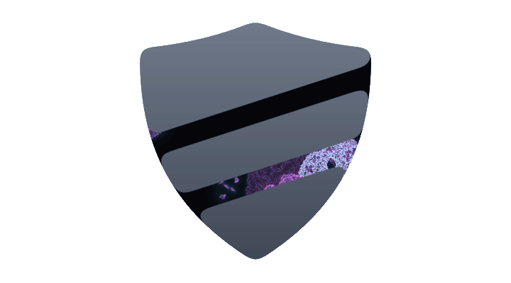
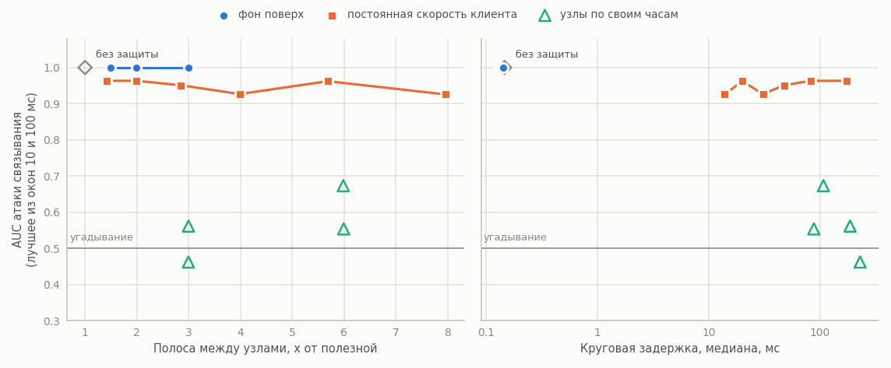
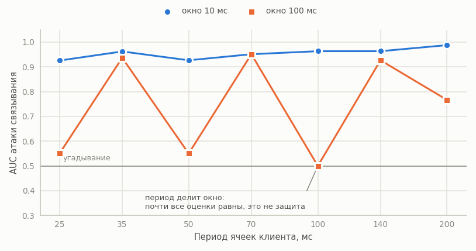
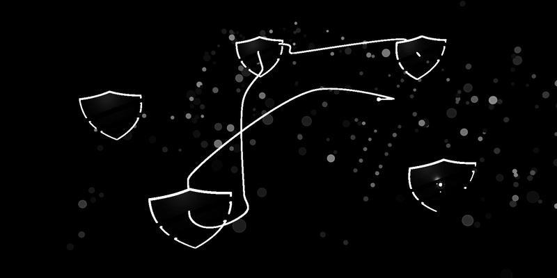

<p align="center"><picture><source media="(prefers-color-scheme: dark)" srcset="docs/img/mark-dark.gif"></picture></p>

<h1 align="center">jimichi</h1>

<p align="center">
  Конфиденциальный обмен сообщениями, скрывающий, кто с кем говорит, и измерения того, чего эта
  защита стоит.
  <br>
  <a href="https://jimichi.org">jimichi.org</a> · <a href="#результаты">Результаты</a> · <a href="#документация">Документация</a> · <a href="README.md">English</a> | Русский
</p>

<p align="center">
  <a href="https://github.com/jimichi-org/jimichi/actions/workflows/ci.yml"></a>
  <a href="https://github.com/jimichi-org/jimichi/releases/latest"></a>
  <a href="https://scorecard.dev/viewer/?uri=github.com/jimichi-org/jimichi"></a>
  <a href="https://doi.org/10.5281/zenodo.23001699"></a>
</p>

- **Цепочка из трёх узлов.** Сообщение идёт с вложенным шифрованием через цепочку, которую клиент выбирает случайно из узлов своего списка; каждый узел снимает ровно один слой и на проводе видит только соседей.
- **Разговор через mailbox.** Два клиента в режиме `-peer` разговаривают через mailbox на последнем узле своих цепочек; сообщения закрыты сквозным слоем (рукопожатие KK и хэш-ратчет поверх того же CryptoProvider), и mailbox хранит только записи постоянного размера, которые не может прочесть.
- **Вопрос.** Защитить содержимое просто. Работа отвечает на более трудный вопрос: сколько всё ещё узнаёт наблюдатель, который видит только тайминги и объёмы, и чем приходится платить, чтобы это отнять. Поэтому в репозитории лежит и сама система, и атака против неё.

## Состояние

| Часть | Сейчас | В плане |
|---|---|---|
| Ключи | сессионные ключи эфемерные, буферы с ними лежат в заблокированной памяти вне кучи Go и зануляются после использования; от выгрузки в swap защищены только эти буферы; сам узел на диск ничего не пишет; копии, которые криптобиблиотеки держат на куче, этим не покрыты ([границы применимости](docs/ru/LIMITATIONS.md)) | блокировка всей памяти процесса ([#36](https://github.com/jimichi-org/jimichi/issues/36)) |
| Ячейки | все ячейки одного размера: сообщение, которое помещается в одну ячейку, не выдаёт свою длину на проводе, более длинное отклоняется с ошибкой и не отправляется | фрагментация и классы размеров ([#68](https://github.com/jimichi-org/jimichi/issues/68)) |
| Узлы | УЦ, живущий только этот прогон, сертифицирует каждый узел; клиент берёт ключи узлов только из комплектов, проверенных по якорю; узел продолжает цепочки только на сертифицированные узлы своего ростера по аутентифицированным каналам (с `-auth`, по умолчанию); узлы перекрёстно проверяют зеркала друг друга и отказывают узлу, подписанные дескрипторы которого противоречат друг другу (`-consistency`); два зеркала всё ещё могут расходиться до 201 с после того, как ротация дошла до них ([границы применимости](docs/ru/LIMITATIONS.md)) | аутентификация инициатора на каналах между узлами ([#56](https://github.com/jimichi-org/jimichi/issues/56)), скрытие набора и роли в первом сообщении рукопожатия ([#57](https://github.com/jimichi-org/jimichi/issues/57)) |
| Разговор | два клиента `-peer` через mailbox на последнем узле; офлайн-отрицаемая аутентификация, показанная подделкой переписки через `cmd/lab -set deny`; mailbox связывает две цепочки пары через их очереди ([модель угроз](docs/ru/THREAT_MODEL.md)) | измерение топологии разговора ([#47](https://github.com/jimichi-org/jimichi/issues/47)), очереди без постоянного идентификатора и цепочки на контакт ([#84](https://github.com/jimichi-org/jimichi/issues/84), [#96](https://github.com/jimichi-org/jimichi/issues/96)) |
| Контейнер клиента | `vault`: файл постоянного размера с одним или двумя томами под своими паролями; `jimichi vault init`, `jimichi vault show`; файл и один пароль скрывают второй том, только если его пароль сгенерирован, а под принуждением этот том легенда, а не иммунитет ([модель угроз](docs/ru/THREAT_MODEL.md)) | клиент `-peer` с `-vault` и измерение контейнера ([#20](https://github.com/jimichi-org/jimichi/issues/20)) |

## Результаты

Пассивный наблюдатель видит только моменты, когда кадры пересекают входной канал и последний канал
между узлами. Он считает кадры в окнах времени для каждого потока и коррелирует каждый входной
поток с каждым выходным. Окно выбирает наблюдатель, поэтому считаются оба, 10 и 100 мс, а на
графике взято лучшее для него. Угадывание это AUC 0.5 и точность top-1 10%.

| Набор | Что меняется | Ревизия | Потоков | Узлов | Прогонов на точку | Окна |
|---|---|---|---|---|---|---|
| main | `none`, фон поверх (`add-*`), постоянная скорость клиента (`fixed-*`) | 2078098 | 10 | 3 | 5 x 30 с | 10 мс, 100 мс |
| rates | `none`, постоянная скорость клиента по периодам (`fixed-*`) | 2078098 | 10 | 3 | 5 x 30 с | 10 мс, 100 мс |
| paced | `none`, узлы по своим часам (`relay-*`), оба (`both-*`), только клиент (`fixed-*`) | 2078098 | 10 | 3 | 5 x 30 с | 10 мс, 100 мс |
| paths | выбор цепочки из 3 среди 5 узлов, из них 1 или 2 подставных | 2078098 | - | 3 | по 100000 цепочек | - |

Набор примитивов c25519, базовое зерно 1. Расписание каждого клиента стартует со случайной фазой; каждое значение AUC, top-1, полосы и круга это медиана прогонов своей конфигурации. Для проверки согласованности наборов набор paced повторяет прогоны только с клиентом: их медианы при окне 10 мс (AUC 0.922 при 70 мс и 0.946 при 35 мс) лежат в разбросе прогонов набора rates (0.890-0.965 и 0.907-0.984).

<picture>
  <source media="(prefers-color-scheme: dark)" srcset="docs/img/tradeoff-ru-dark.png">
  
</picture>

| Набор | Защита | Полоса между узлами | Медиана круга | AUC, 10 мс | AUC, 100 мс | Top-1, 10 мс |
|---|---|---|---|---|---|---|
| main | нет | x1.00 | 0.146 мс | 1.000 | 1.000 | 100% |
| main | фон поверх, +2x | x2.99 | 0.131 мс | 1.000 | 1.000 | 100% |
| rates | постоянная скорость клиента, 70 мс | x2.85 | 48 мс | 0.951 | 0.951 | 70% |
| rates | постоянная скорость клиента, 35 мс | x5.69 | 20 мс | 0.962 | 0.937 | 70% |
| paced | узлы по своим часам, 66.5 мс | x3.00 | 187 мс | 0.562 | 0.463 | 5% |
| paced | узлы по своим часам, 33.25 мс | x6.00 | 88 мс | 0.554 | 0.487 | 15% |
| paced | оба, клиент 70 мс, узлы 66.5 мс | x3.00 | 230 мс | 0.462 | 0.442 | 3% |
| paced | оба, клиент 35 мс, узлы 33.25 мс | x5.99 | 108 мс | 0.673 | 0.472 | 20% |

- Фон поверх сообщений (main, от `add-0.5x` до `add-2x`, оба окна) не помогает вообще: даже при полосе x2.99 между узлами AUC равен 1.000, а top-1 100% в каждом прогоне, то есть связывается каждый поток.
- Постоянная скорость клиента (rates, от `fixed-25ms` до `fixed-200ms`) связывание тоже не останавливает: каждый клиент тикает со своей фазой, узлы пересылают каждую ячейку сразу, и при окне 10 мс медианы AUC на любом периоде лежат между 0.93 и 0.99.
  - При окне 100 мс AUC падает до 0.50-0.55 только там, где период делит окно (`fixed-25ms`, `fixed-50ms`, `fixed-100ms`), а на остальных периодах держится на 0.77-0.95: при делящем периоде почти все оценки равны, и о защите это ничего не говорит.

<picture>
  <source media="(prefers-color-scheme: dark)" srcset="docs/img/window-ru-dark.png">
  
</picture>

- Отправка узлами по своим часам (paced, `relay-*` и `both-*`, оба окна): медианы AUC этой атаки, которая считает только ячейки, лежат между 0.44 и 0.67 против 0.94-1.00 в остальных строках, но показать, что атака падает до угадывания, эти прогоны не могут: четыре медианы из восьми лежат вне 0.45-0.55, а такой вывод требует интервала эквивалентности внутри этой полосы, с величиной и допуском, заданными до серии; пять прогонов такого интервала не дают.
  - 95% интервал отдельного прогона включает 0.5 в 33 случаях из 40 (из остальных семи три лежат выше, четыре ниже). Пять прогонов по десять потоков не отличают малую остаточную утечку от её отсутствия, это покажет полная серия.
  - Цена: постоянный поток на каждом канале, по которому шлёт узел, и около 2.7-2.8 периода узла к кругу (187 мс при 66.5 мс, 88 мс при 33.25 мс). В `both-*` период узла на 5% короче клиентского, чтобы пропущенный тик наверстать; `relay-*` берёт те же периоды узла при клиенте, который шлёт сразу.
- Выбор цепочки (paths, 3 из 5 узлов, по 100000 цепочек): для клиента без `-peer`, который выбирает одну цепочку из полных зеркал, один подставной узел попадает в 0.599 цепочек (по модели 0.600); из двух хотя бы один попадает в 0.900 (0.900), а вход и выход оба подставные в 0.100 (0.100), каждое значение в пределах одной стандартной ошибки от модели. Подставной вход, который не отдаёт узел, закреплённый выход клиента `-peer` и его пересборки меняют эти доли ([программа исследования](docs/ru/EXPERIMENT.md), блок 3; [границы применимости](docs/ru/LIMITATIONS.md)).

### Границы этих чисел

- Один процесс на loopback, а не стенд kind ниже: сетевых задержек нет, нет сертификатов, ротации онион-ключей и ограничений на один адрес, каналы между узлами анонимные; эмуляция сети в плане ([#46](https://github.com/jimichi-org/jimichi/issues/46)).
- Эхо-топология: последний узел возвращает каждое сообщение, разговор двух клиентов через mailbox в эти числа не входит ([#47](https://github.com/jimichi-org/jimichi/issues/47)).
- 5 прогонов на точку: различия значимыми не заявляются; полная серия по тридцать прогонов на точку впереди ([#23](https://github.com/jimichi-org/jimichi/issues/23)).
- Атака базовая: она считает только ячейки и ранжирует пары потоков по корреляции Пирсона подсчётов в окнах, только в прямом направлении и без сдвига во времени; моменты открытия и закрытия соединений цепочки совпадают вдоль неё и в атаку пока не входят ([#43](https://github.com/jimichi-org/jimichi/issues/43)), более сильные атаки в плане ([#67](https://github.com/jimichi-org/jimichi/issues/67), [#116](https://github.com/jimichi-org/jimichi/issues/116)).
- Наблюдатель смотрит на два канала и не моделирует входной узел, который видит ячейки клиента напрямую; скрывает ли от него постоянная скорость клиента моменты отправки, пока не измерено: различитель ячеек есть ([EXPERIMENT](docs/ru/EXPERIMENT.md), блок 7), его серия в плане ([#23](https://github.com/jimichi-org/jimichi/issues/23)).
- Круг без защиты или только с фоном короче миллисекунды и отличается между наборами примерно на 0.01 мс (0.14-0.15 мс без защиты), поэтому его последние цифры ничего не значат.
- Серии идут при остановленном кластере kind и без сборки на хосте; в каждой строке `correlation-*` записаны зёрна, ревизия кода и загрузка внутри ВМ, где идёт обвязка, в каждой строке `paths-*` зерно и ревизия. Зёрна задают расписания клиентов, а не прогон: в наборе paced, запущенном дважды с теми же зёрнами и образом, одна медиана при часах узлов сдвинулась примерно на 0.15. См. [границы применимости](docs/ru/LIMITATIONS.md).

## Воспроизведение

Числа выше получены этими прогонами:

```
bash scripts/sweep.sh -set main -flows 10 -duration 30s -repeats 5 -bins 10ms,100ms
bash scripts/sweep.sh -set rates -flows 10 -duration 30s -repeats 5 -bins 10ms,100ms
bash scripts/sweep.sh -set paced -flows 10 -duration 30s -repeats 5 -bins 10ms,100ms
bash scripts/sweep.sh -set paths -rogue 1
bash scripts/sweep.sh -set paths -rogue 2
```

- `scripts/sweep.sh` собирает образ lab, запускает в нём `cmd/lab` и записывает ревизию в каждую строку, с пометкой `-dirty`, если дерево отличается от коммита.
- Отчёты это JSON-файлы в `artifacts/`, которых нет в репозитории: строки с конфигурацией, зёрнами и ревизией (`correlation-*`, `paths-*`), медианы (`summary-*`), подсчёты по окнам (`detail-*`) и вердикты (`deny-*`). Графики выше построены по отчётам `summary-*`. Запускать серии при остановленном кластере kind и без сборки на хосте.

## Что измеряется

| Блок | Сейчас | В плане |
|---|---|---|
| Метаданные | атака корреляции связывает потоки на входном канале с потоками на последнем канале между узлами только по таймингам и числу ячеек; AUC и точность top-1 ([результаты](#результаты)), а TPR при FPR 0.01 в отчётах, в зависимости от интенсивности фонового трафика, постоянной скорости клиента и отправки узлами по своим часам | уровни задержки на узле ([#45](https://github.com/jimichi-org/jimichi/issues/45)), классы размеров сообщений ([#68](https://github.com/jimichi-org/jimichi/issues/68)), топология разговора, два входа и mailbox ([#47](https://github.com/jimichi-org/jimichi/issues/47)) |
| Частичная компрометация | как часто случайно выбранная цепочка встречает подставные узлы, посчитано и измерено на выборке тем же выбором, что у клиента без `-peer` (`cmd/lab -set paths`); что один узел знает о маршруте по своей позиции, выведено из протокола; тест lab с настоящими узлами: узел с сертификатом чужого удостоверяющего центра не попадает ни в одну цепочку | что видят и связывают узлы стенда по своим записям, измеренное, а не выведенное ([#117](https://github.com/jimichi-org/jimichi/issues/117)) |
| Ключевой материал | переключатели, которые запускают узел без каждой из мер (`-keymem`, `-harden`) | поиск байтов известного ключа в дампе памяти работающего узла, со включённой блокировкой памяти и запретом дампов и без них, и тот же поиск по образу контейнера и файлам узла ([#24](https://github.com/jimichi-org/jimichi/issues/24)) |
| Прямая секретность | модульные тесты: служебная ячейка установки цепочки перестаёт открываться, когда узел освобождает онион-ключ, под который она собрана | атака на служебные ячейки установки цепочки, записанные соседом, ключами, снятыми из памяти узла, в зависимости от возраста записи ([#24](https://github.com/jimichi-org/jimichi/issues/24)) |
| Цена | круговая задержка через цепочку, множитель полосы от фона и заполнения, бенчмарки согласования ключа, подписи и шифрования ячейки, ГОСТ против X25519 | пропускная способность узла при насыщении, полезная скорость на клиента, цена установки на узле с двумя онион-ключами, задержка для цепочки из одного узла, вклад блокировки памяти ([#118](https://github.com/jimichi-org/jimichi/issues/118)) |

Модель угроз строится по методике ФСТЭК России от 05.02.2021, сценарии называются словами.

## Система

<p align="center"><a href="docs/ru/ARCHITECTURE.md#выбор-цепочки"></a><br><sub>Пять узлов и цепочки из трёх, выбранные среди них так, как выбирает клиент без <code>-peer</code>; клиент <code>-peer</code> закрепляет выход на mailbox и выбирает остальные. Обвязка lab, по которой сняты числа корреляции выше, использует одну постоянную цепочку. См. <a href="docs/ru/ARCHITECTURE.md#выбор-цепочки">архитектуру</a>.</sub></p>

## Криптография

| Набор | Примитивы | С чем сверен |
|---|---|---|
| `c25519`, по умолчанию | X25519, XChaCha20-Poly1305, Ed25519 | тесты соответствия; подпись с RFC 8032 |
| `gost`, `-suite gost` | VKO ГОСТ Р 34.10-2012, Кузнечик в режиме MGM, Стрибог | тесты соответствия; контрольные примеры своих стандартов |

Все примитивы находятся за единым интерфейсом `CryptoProvider`. Набор по умолчанию держит результаты сравнимыми с зарубежными работами; различие между наборами указывает на набор, а не на стенд. См. [docs/ru/CRYPTO.md](docs/ru/CRYPTO.md).

## Документация

- [docs/ru/ARCHITECTURE.md](docs/ru/ARCHITECTURE.md) - компоненты, поток сообщения, формат ячейки.
- [docs/ru/THREAT_MODEL.md](docs/ru/THREAT_MODEL.md) - активы, нарушители, угрозы, отрицаемость.
- [docs/ru/CRYPTO.md](docs/ru/CRYPTO.md) - контракт CryptoProvider.
- [docs/ru/EXPERIMENT.md](docs/ru/EXPERIMENT.md) - модели нарушителя, метрики, блоки экспериментов.
- [docs/ru/LIMITATIONS.md](docs/ru/LIMITATIONS.md) - границы применимости результатов.
- [docs/ru/GLOSSARY.md](docs/ru/GLOSSARY.md) - термины.

## Запуск стенда

```
kind create cluster --config deploy/kind/cluster.yaml
make images
kind load docker-image jimichi/relay:dev jimichi/client:dev --name jimichi
kubectl apply -f deploy/base/relay.yaml -f deploy/base/network.yaml
kubectl -n jimichi wait --for=condition=Available deployment -l app=relay --timeout=180s
bash scripts/enroll.sh
kubectl apply -f deploy/base/client.yaml
bash scripts/introduce.sh
```

Последние пять шагов выполняет `make deploy`. В пространстве имён `jimichi` поднимаются пять узлов и два клиента.

<details><summary>Выдача сертификатов, выбор цепочки и знакомство клиентов</summary>

Узел при старте создаёт ключ подписи в памяти и ждёт выдачи сертификата: `scripts/enroll.sh` собирает `cmd/jimichi` и запускает на хосте `jimichi enroll`, который через port-forward сертифицирует каждый узел под УЦ, живущим только этот прогон, отдаёт каждому узлу ростер сертифицированных узлов и кладёт открытый ключ УЦ, якорь, в ConfigMap `jimichi-ca`. После этого узел публикует подписанный дескриптор на порту 9100, держит проверенные дескрипторы остальных узлов ростера и продолжает цепочки только на них по аутентифицированным каналам. После перезапуска узла нужно перезапустить все узлы и заново выдать сертификаты, потому что процесс принимает один сертификат и один ростер: `kubectl -n jimichi rollout restart deployment -l app=relay`, затем `make enroll`.

Клиенты `client-a` и `client-b` работают с `-peer` и держат очереди на mailbox узла `relay-5`: `client-a` шлёт сообщение каждые 2 с, `client-b` отвечает на каждое. Клиент перечисляет все пять узлов и строит цепочку из трёх (`-hops`), которая кончается на mailbox. При старте он случайно выбирает вход среди остальных четырёх, просит у него подписанные комплекты всех узлов списка, проверяет по якорю каждый полученный комплект и только после этого выбирает середину среди проверенных узлов. Вход может не отдать один узел списка, а комплект, который не прошёл проверку, считается неотданным (`-missing`, по умолчанию 1; комплекты входа и mailbox должны пройти проверку), и подставной вход так сужает выбор ([границы применимости](docs/ru/LIMITATIONS.md)). Цепочку клиент в журнал не пишет. Когда цепочка кончается, он снова строит ту же цепочку через тот же вход, а новые середины выбирает, только когда её построить нельзя, не больше двух раз за процесс. Клиент без `-peer` после любого сбоя завершается и при следующем запуске выбирает новую цепочку; `-fixed-chain` оставляет порядок списка для измерений, которым нужен известный путь.

Каждый клиент при старте печатает только хэш своей карточки контакта, саму карточку отдаёт admin-порт на loopback. `scripts/introduce.sh` перезапускает обоих клиентов, через port-forward забирает каждую карточку, сверяет её с хэшем в журнале того же контейнера и передаёт другому клиенту, который закрепляет её на всю жизнь процесса. Перезапущенный клиент это новая личность, поэтому `make enroll`, `make deploy` и `make start` знакомят клиентов заново, а `make introduce` делает только это. Клиент, которому после закрепления предлагают другую карточку, отвечает 409 и останавливается до перезапуска оператором.

</details>

Агрегированные счётчики раз в минуту идут в stdout и на порт 9101 только на loopback, читаются
через port-forward:

```
kubectl -n jimichi port-forward deployment/relay-3 9101:9101
curl -s localhost:9101/stats
```

## Раскладка

<details><summary>Дерево пакетов</summary>

```
cmd/          точки входа: relay, client, jimichi (CLI стенда), lab
crypto/       интерфейс CryptoProvider
  gost/       набор ГОСТ
  c25519/     набор X25519 / XChaCha20-Poly1305 / Ed25519
  suite/      выбор набора по имени
  secmem/     буферы ключей под mlock, без дампов, с занулением
  providertest/ тесты соответствия для обоих наборов
wire/         ячейки постоянного размера, вложенные слои, порядок counter
link/         канальное шифрование между соседями, кадры одного размера
pki/          сертификат, дескриптор и запрос узла, выдача и проверка
relay/        узел-ретранслятор
client/       выбор цепочки, отправка, ответы выходного узла, фоновый трафик
noise/        машина рукопожатия в форме Noise над CryptoProvider
e2e/          сквозной слой: карточка контакта, рукопожатие KK, хэш-ратчет
mailbox/      очереди записей сквозного слоя на выходе, только в памяти
conversation/ разговор клиента с контактом: заявки, окно put, пересборка
vault/        контейнер клиента постоянного размера с одним или двумя томами, profile/ для -peer
lab/          обвязка прогонов и наблюдатель, metrics/, scenario/ (подделка переписки
              получателем); report/ пока пустой
web/          дашборд стенда, в плане (#21), пока пустой пакет
deploy/       kind/ конфигурации кластера и base/ манифесты стенда
docs/         документация, en/ и ru/
```

</details>

## Требования

Go 1.27. Блокировка памяти и запрет дампов работают только на Linux, как и запланированные
сценарии извлечения ключей ([#24](https://github.com/jimichi-org/jimichi/issues/24)); на других
платформах собираются заглушки, которые сообщают, что память не заблокирована, и узел
отказывается стартовать. Docker и kind для стенда; сборка на Compose для разработки в плане
([#22](https://github.com/jimichi-org/jimichi/issues/22)).

## Цитирование

Цитировать по [CITATION.cff](CITATION.cff), который GitHub предлагает как "Cite this repository", или по DOI [10.5281/zenodo.23001699](https://doi.org/10.5281/zenodo.23001699).

## Лицензия

AGPL-3.0-or-later. См. [LICENSE](LICENSE).
