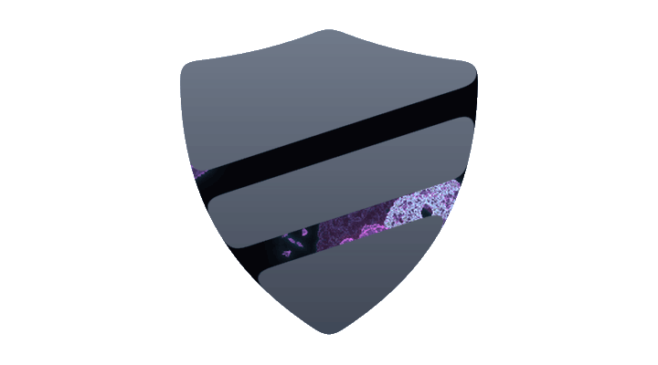
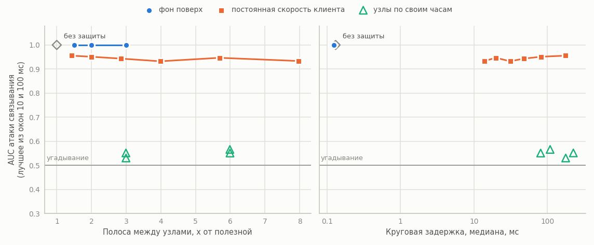
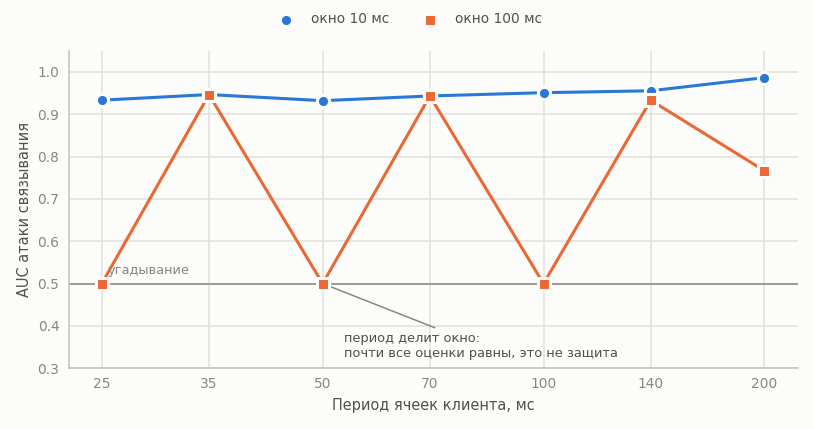
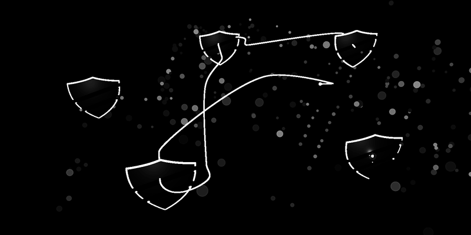

<p align="center"><picture><source media="(prefers-color-scheme: dark)" srcset="docs/img/mark-dark.gif"></picture></p>

<h1 align="center">jimichi</h1>

<p align="center">
  Конфиденциальный обмен сообщениями, скрывающий, кто с кем говорит, и измерения того, чего эта
  защита стоит.
  <br>
  <a href="https://jimichi.org">jimichi.org</a> · <a href="#результаты">Результаты</a> · <a href="#документация">Документация</a> · <a href="README.md">English</a> | Русский
</p>

<p align="center">
  <a href="https://github.com/jimichi-org/jimichi/actions/workflows/ci.yml"></a>
  <a href="https://github.com/jimichi-org/jimichi/releases/latest"></a>
  <a href="https://scorecard.dev/viewer/?uri=github.com/jimichi-org/jimichi"></a>
  <a href="https://doi.org/10.5281/zenodo.23001699"></a>
</p>

- **Цепочка из трёх узлов.** Сообщение идёт с вложенным шифрованием через цепочку, которую клиент выбирает случайно из узлов своего списка; каждый узел снимает ровно один слой и на проводе видит только соседей.
- **Разговор через mailbox.** Два клиента в режиме `-peer` разговаривают через mailbox на последнем узле своих цепочек; сообщения закрыты сквозным слоем (рукопожатие KK и хэш-ратчет поверх того же CryptoProvider), и mailbox хранит только записи постоянного размера, которые не может прочесть.
- **Вопрос.** Защитить содержимое просто. Работа отвечает на более трудный вопрос: сколько всё ещё узнаёт наблюдатель, который видит только тайминги и объёмы, и чем приходится платить, чтобы это отнять. Поэтому в репозитории лежит и сама система, и атака против неё.

## Состояние

| Часть | Сейчас | В плане |
|---|---|---|
| Ключи | сессионные ключи эфемерные, буферы с ними лежат в заблокированной памяти вне кучи Go и зануляются после использования; от выгрузки в swap защищены только эти буферы; сам узел на диск ничего не пишет; копии, которые криптобиблиотеки держат на куче, этим не покрыты ([границы применимости](docs/ru/LIMITATIONS.md)) | блокировка всей памяти процесса ([#36](https://github.com/jimichi-org/jimichi/issues/36)) |
| Ячейки | все ячейки одного размера: сообщение, которое помещается в одну ячейку, не выдаёт свою длину на проводе, более длинное отклоняется с ошибкой и не отправляется | фрагментация и классы размеров ([#68](https://github.com/jimichi-org/jimichi/issues/68)) |
| Узлы | УЦ, живущий только этот прогон, сертифицирует каждый узел; клиент берёт ключи узлов только из комплектов, проверенных по якорю; узел продолжает цепочки только на сертифицированные узлы своего ростера по аутентифицированным каналам (с `-auth`, по умолчанию); узлы перекрёстно проверяют зеркала друг друга и отказывают узлу, подписанные дескрипторы которого противоречат друг другу (`-consistency`); два зеркала всё ещё могут расходиться до 201 с после того, как ротация дошла до них ([границы применимости](docs/ru/LIMITATIONS.md)) | аутентификация инициатора на каналах между узлами ([#56](https://github.com/jimichi-org/jimichi/issues/56)), скрытие набора и роли в первом сообщении рукопожатия ([#57](https://github.com/jimichi-org/jimichi/issues/57)) |
| Разговор | два клиента `-peer` через mailbox на последнем узле; офлайн-отрицаемая аутентификация, показанная подделкой переписки через `cmd/lab -set deny`; mailbox связывает две цепочки пары через их очереди ([модель угроз](docs/ru/THREAT_MODEL.md)) | измерение топологии разговора ([#47](https://github.com/jimichi-org/jimichi/issues/47)), очереди без постоянного идентификатора и цепочки на контакт ([#84](https://github.com/jimichi-org/jimichi/issues/84), [#96](https://github.com/jimichi-org/jimichi/issues/96)) |
| Контейнер клиента | `vault`: файл постоянного размера с одним или двумя томами под своими паролями; `jimichi vault init`, `jimichi vault show`; `cmd/client -peer -vault` берёт личность и контакт из тома и после перезапуска поднимается запертым; файл и один пароль скрывают второй том, только если его пароль сгенерирован, а под принуждением этот том легенда, а не иммунитет ([модель угроз](docs/ru/THREAT_MODEL.md)) | измерение контейнера ([#20](https://github.com/jimichi-org/jimichi/issues/20)) |

## Результаты

Пассивный наблюдатель видит только моменты, когда кадры пересекают входной канал и последний канал
между узлами. Он считает кадры в окнах времени для каждого потока и коррелирует каждый входной
поток с каждым выходным. Окно выбирает наблюдатель, поэтому считаются оба, 10 и 100 мс, а на
графике взято лучшее для него. Угадывание это AUC 0.5 и точность top-1 10%.

| Набор | Что меняется | Ревизия | Потоков | Узлов | Прогонов на точку | Окна |
|---|---|---|---|---|---|---|
| main | `none`, фон поверх (`add-*`), постоянная скорость клиента (`fixed-*`) | 8a7b140 | 10 | 3 | 5 x 30 с | 10 мс, 100 мс |
| rates | `none`, постоянная скорость клиента по периодам (`fixed-*`) | 8a7b140 | 10 | 3 | 5 x 30 с | 10 мс, 100 мс |
| paced | `none`, узлы по своим часам (`relay-*`), оба (`both-*`), только клиент (`fixed-*`) | 8a7b140 | 10 | 3 | 5 x 30 с | 10 мс, 100 мс |
| paths | выбор цепочки из 3 среди 5 узлов, из них 1 или 2 подставных | 2078098 | - | 3 | по 100000 цепочек | - |

Набор c25519, базовое зерно 1. Серия от 2026-11-18 на `8a7b140` содержит 110 прогонов
на loopback, с двумя окнами на каждый прогон. Расписание каждого клиента начинается со случайной
фазы. В таблице указаны медианы по каждой конфигурации. В `paced`, при постоянной скорости только
клиента, медианы AUC пяти прогонов для окна 10 мс равны 0.953 при 70 мс и 0.960 при 35 мс.
Соответствующие диапазоны прогонов `rates` составляют 0.890-0.963 и 0.914-0.973.

<picture>
  <source media="(prefers-color-scheme: dark)" srcset="docs/img/tradeoff-ru-dark.png">
  
</picture>

| Набор | Защита | Полоса между узлами | Медиана круга | AUC, 10 мс | AUC, 100 мс | Top-1, 10 мс |
|---|---|---|---|---|---|---|
| main | нет | x1.00 | 0.131 мс | 1.000 | 1.000 | 100% |
| main | фон поверх, +2x | x2.99 | 0.115 мс | 1.000 | 1.000 | 100% |
| rates | постоянная скорость клиента, 70 мс | x2.85 | 48 мс | 0.943 | 0.943 | 60% |
| rates | постоянная скорость клиента, 35 мс | x5.69 | 20 мс | 0.947 | 0.947 | 70% |
| paced | узлы по своим часам, 66.5 мс | x3.00 | 178 мс | 0.531 | 0.516 | 2.5% |
| paced | узлы по своим часам, 33.25 мс | x5.99 | 81 мс | 0.551 | 0.523 | 10% |
| paced | оба, клиент 70 мс, узлы 66.5 мс | x2.99 | 226 мс | 0.552 | 0.469 | 5% |
| paced | оба, клиент 35 мс, узлы 33.25 мс | x5.99 | 109 мс | 0.566 | 0.434 | 10% |

- Фон поверх сообщений сохраняет медианы AUC 1.000 и top-1 100% в обоих окнах для трёх
  проверенных интенсивностей. Фон +2x требует x2.99 полосы между узлами.
- При постоянной скорости клиента медианы AUC в окне 10 мс составляют 0.932-0.987.
  В окне 100 мс медиана равна 0.500 при периодах клиента 25, 50 и 100 мс, когда окно содержит
  целое число периодов и оценки совпадают. Остальные медианы лежат в диапазоне 0.767-0.947.

<picture>
  <source media="(prefers-color-scheme: dark)" srcset="docs/img/window-ru-dark.png">
  
</picture>

- При отправке узлами по своим часам медианы AUC для `relay-*` и `both-*` составляют
  0.434-0.566 для обоих окон. Четыре из восьми медиан лежат вне 0.45-0.55. Оценки по пяти
  прогонам на конфигурацию описательные. В 36 окнах из 40 интервал 95% отдельного прогона
  включает 0.5. Один интервал выше 0.5, три ниже.
  - Медианы круговой задержки при часах только узлов составляют 178 мс для периода 66.5 мс
    и 81 мс для 33.25 мс, около 2.4-2.7 периода узла. Узлы шлют с постоянной скоростью на
    каждом канале. В `both-*` период узла на 5% короче периода клиента.

- Выбор цепочки (paths, 3 из 5 узлов, по 100000 цепочек): для клиента без `-peer`, который выбирает одну цепочку из полных зеркал, один подставной узел попадает в 0.599 цепочек (по модели 0.600); из двух хотя бы один попадает в 0.900 (0.900), а вход и выход оба подставные в 0.100 (0.100), каждое значение в пределах одной стандартной ошибки от модели. Подставной вход, который не отдаёт узел, закреплённый выход клиента `-peer` и его пересборки меняют эти доли ([программа исследования](docs/ru/EXPERIMENT.md), блок 3; [границы применимости](docs/ru/LIMITATIONS.md)).

### Границы этих чисел

- Один процесс на loopback, а не стенд kind ниже: сетевых задержек нет, нет сертификатов, ротации онион-ключей и ограничений на один адрес, каналы между узлами анонимные; эмуляция сети в плане ([#46](https://github.com/jimichi-org/jimichi/issues/46)).
- Эхо-топология: последний узел возвращает каждое сообщение, разговор двух клиентов через mailbox в эти числа не входит ([#47](https://github.com/jimichi-org/jimichi/issues/47)).
- 5 прогонов на точку: различия значимыми не заявляются; полная серия по тридцать прогонов на точку впереди ([#23](https://github.com/jimichi-org/jimichi/issues/23)).
- Атака базовая: она считает только ячейки и ранжирует пары потоков по корреляции Пирсона подсчётов в окнах, только в прямом направлении и без сдвига во времени; моменты открытия и закрытия соединений цепочки совпадают вдоль неё и в атаку пока не входят ([#43](https://github.com/jimichi-org/jimichi/issues/43)); обучаемый коррелятор остаётся в плане ([#67](https://github.com/jimichi-org/jimichi/issues/67)); отдельная серия временной метки измерена ([#116](https://github.com/jimichi-org/jimichi/issues/116), [результаты](#результаты-временной-метки)).
- Наблюдатель смотрит на два канала и не моделирует входной узел, который видит ячейки клиента напрямую; скрывает ли от него постоянная скорость клиента моменты отправки, пока не измерено: различитель ячеек есть ([EXPERIMENT](docs/ru/EXPERIMENT.md), блок 7), его серия в плане ([#23](https://github.com/jimichi-org/jimichi/issues/23)).
- Медиана круга без защиты по трём наборам лежит в диапазоне 0.130-0.157 мс. Различия
  в пределах долей миллисекунды относятся к условиям стенда и хоста.
- В учёте остались все 110 прогонов, включая 169 сообщений без ответа в десяти прогонах с
  постоянным периодом 200 мс. Обрывов цепочек, срабатываний лимитов и потерь ячеек нет.
  Кластер kind был остановлен. В отчётах записаны загрузка ВМ, зёрна и ревизия. В прежних
  сериях при тех же настройках наблюдался разброс между прогонами. [Границы применимости](docs/ru/LIMITATIONS.md).

## Воспроизведение

Числа выше получены этими прогонами:

```
bash scripts/sweep.sh -set main -flows 10 -duration 30s -repeats 5 -bins 10ms,100ms
bash scripts/sweep.sh -set rates -flows 10 -duration 30s -repeats 5 -bins 10ms,100ms
bash scripts/sweep.sh -set paced -flows 10 -duration 30s -repeats 5 -bins 10ms,100ms
bash scripts/sweep.sh -set paths -rogue 1
bash scripts/sweep.sh -set paths -rogue 2
```

- `scripts/sweep.sh` собирает образ lab, запускает в нём `cmd/lab` и записывает ревизию в каждую строку, с пометкой `-dirty`, если дерево отличается от коммита.
- Отчёты это JSON-файлы в `artifacts/`, которых нет в репозитории: строки с конфигурацией, зёрнами и ревизией (`correlation-*`, `paths-*`), медианы (`summary-*`), подсчёты по окнам (`detail-*`) и вердикты (`deny-*`). Графики выше построены по отчётам `summary-*`. Запускать серии при остановленном кластере kind и без сборки на хосте.

## Результаты временной метки

Историческая серия c25519: 40 блоков повторов, 24 условия в блоке, 960 завершённых запусков.
У каждого режима клиента, периода узлов и воздействия свой знаменатель 40. Основная метрика:
верное указание цели при открытой исходной цепочке и эхе отдельной пробы до отсечки.

| Проверенные периоды узлов, мс | Верно + отзывчиво, активное воздействие | Отзывчивая цель, активное воздействие и sham |
|---|---:|---:|
| выключено | 40/40 | 40/40 в каждом воздействии |
| 25, 47.5, 50, 52.5 | 0/40 для каждого периода | 40/40 в каждом воздействии для каждого периода |
| 75 | 0/40 | 0/40 в каждом воздействии |

Числа получены отдельно для обоих режимов клиента: Immediate с добавочным фоном и ConstantRate
с периодом 50 мс. Режимы и периоды не объединены. Все попытки установились и оценены; все
исходы сохранены. При 75 мс все шесть исходных цепочек закрылись в каждом из 160 активных/sham
запусков двух режимов: это потеря доступности, а не защита. В полной таблице сохранены семь
неверных активных указаний и семь указаний sham; у Immediate без часов узлов sham дал 4/40.
Один возврат Send отзывчивости не доказывает. Независимая единица сравнения: блок повтора,
а не его шесть цепочек.

Измерено 2026-11-09 на чистом коммите
[`f0f188539ca9241b67ad6593f1e66687e80ed967`](https://github.com/jimichi-org/jimichi/commit/f0f188539ca9241b67ad6593f1e66687e80ed967),
оптимизированный Go 1.27.3, Linux/amd64, базовое зерно 1. SHA256 бинарника:
`404796bd0feb555b2f04629169e979f4531303dc5188ab71eaba9746be521ae1`.
Минутная нагрузка Linux по всем 1920 отсчётам до/после: минимум/медиана/максимум 0.34/0.69/1.32
в среде с заявленными 32 CPU. Это load average, не проценты и не независимые попытки;
порога нагрузки и исключений после просмотра данных не было. Влияние нагрузки на время не выделено.

Один процесс на loopback с эхом: задерживается один поток клиент-вход, пять кандидатов без
задержки, оцениваются завершённые кадры вперёд к узлу 3 вместе с заполнением, известны эпоха
и общие часы, поиск кода/сдвига фиксирован. Ноль наблюдённых основных исходов не устанавливает
нулевую вероятность, порог периода или стойкость к произвольным активным атакам. Калибровка
детектора при глобальном отсутствии метки не ограничивает ошибочную атрибуцию с меткой.
Полная таблица и методика приведены в [EXPERIMENT](docs/ru/EXPERIMENT.md), блок 2. У этих чисел
историческая ревизия; пассивная серия и кооперативная серия памяти ключей сохраняют свои.

## Результаты кооперативной проверки памяти ключей

Точные непрерывные 32-байтовые вхождения на выбранный ключ ячейки клиента в разобранных Object
payloads (`go-exported-object-payloads-v1`), после эха через три аутентифицированных узла:

| Набор | Политика | active | closed-now | closed-1s |
|---|---|---:|---:|---:|
| c25519 | none | 3 | 3 | 3 |
| c25519 | all | 2 | 2 | 2 |
| gost | none | 3 | 3 | 3 |
| gost | all | 1 | 0 | 0 |

Для каждого условия запланированы и оценены 30 новых процессов; оценены все 360, исключений нет.
Каждый выбранный ключ в каждом процессе дал указанное число. Наличие хотя бы одного ключа:
30/30, кроме двух точек после Close у ГОСТ `all`, где 0/30. Знаменатель каждого хопа: 30 процессов,
а не 90 независимых наблюдений. В точках разные ключи и процессы; числа описательные,
без p-значений, доверительных интервалов и заявления о превосходстве.

Измерено 2026-11-09 на чистом коммите
[`eddddb226e7224140f8655b1566a55ce33f3ceda`](https://github.com/jimichi-org/jimichi/commit/eddddb226e7224140f8655b1566a55ce33f3ceda),
оптимизированная сборка Go 1.27.3, Linux/amd64, зерно 1. SHA256 бинарника:
`a715234e5347d3ade2689dd585cf7c5cc36c82c1e9ec26c2cd29ffedc7067dc7`.
Агрегированные строки и сводки независимо пересчитаны; команды и методика приведены в
[EXPERIMENT](docs/ru/EXPERIMENT.md), блок 4.

Точное представление c25519 осталось наблюдаемым под `all` после Close. Нули ГОСТ означают только
ненаблюдение в этом представлении: преобразованные состояния и пропуски экспорта не ищутся.
Основные защищённые mmap-буферы вне него и при живых ключах. `none`/`all` меняет несколько мер
вместе. Дополнительные точные совпадения не позволяют отличить остаточные представления библиотек
от возможных копий компилятора/runtime, вызванных инструментированием.
Числа не устанавливают покрытие всей памяти, стирание, срок стирания, эффективность запрета
дампов или защиту от привилегированного получения памяти. Естественный GC и фактические задержки относятся к этому расписанию.

При получении данных kind остановлен, параллельных сборок и записей исходников не было. Мониторинг
CPU всего хоста дал 30 отсчётов во время серии: 3-33%, медиана 11.5%, среднее 12.4%. Они включают
работу проверки и не выделяют постороннюю нагрузку. Строки по нагрузке не исключались; выводов
о производительности или устойчивости к нагрузке нет.

## Кооперативные наблюдения узлов

В блоке 3 исследуются зарегистрированные кооперативные виды на собственном loopback-стенде.
Серия c25519 снята на `ee804c8`, серия ГОСТ на `8a7b140`. У них отдельные бинарники и
регистрации. [Методика и происхождение](docs/ru/EXPERIMENT.md#записанные-результаты-наблюдений-узлов).

| Набор | Прогоны Primary, compromise / collude / mailbox | Плановые единицы |
|---|---|---|
| c25519 | 321 / 270 / 120 | 10272 / 3150 / 1920 |
| ГОСТ | 33 / 27 / 20 | 673 / 216 / 320 |

На c25519 все 13 интервалов Compromise укладываются в зарегистрированный допуск модели ±0,05.
Joint использует два исходных отчёта c25519 Primary. После поправки Холма при семейном уровне
0,05 отклонены шесть из десяти невырожденных сравнений. Три сравнения вырождены. Серия ГОСТ
описательная, в Compromise учтены два заявленных случая без пары. В обоих семействах ГОСТ
по 13 позиций `null/unsupported`. Выводы относятся к зарегистрированным видам, признакам и
нагрузкам. [Границы](docs/ru/LIMITATIONS.md).

## Что измеряется

| Блок | Сейчас | В плане |
|---|---|---|
| Метаданные | атака корреляции связывает потоки на входном канале с потоками на последнем канале между узлами только по таймингам и числу ячеек; AUC и точность top-1 ([результаты](#результаты)), а TPR при FPR 0.01 в отчётах, в зависимости от интенсивности фонового трафика, постоянной скорости клиента и отправки узлами по своим часам | уровни задержки на узле ([#45](https://github.com/jimichi-org/jimichi/issues/45)), классы размеров сообщений ([#68](https://github.com/jimichi-org/jimichi/issues/68)), топология разговора, два входа и mailbox ([#47](https://github.com/jimichi-org/jimichi/issues/47)) |
| Частичная компрометация | как часто случайно выбранная цепочка встречает подставные узлы, посчитано и измерено на выборке тем же выбором, что у клиента без `-peer` (`cmd/lab -set paths`); что один узел знает о маршруте по своей позиции, выведено из протокола; тест lab с настоящими узлами: узел с сертификатом чужого удостоверяющего центра не попадает ни в одну цепочку; [кооперативные наблюдения](#кооперативные-наблюдения-узлов) для обоих наборов ([#117](https://github.com/jimichi-org/jimichi/issues/117)) | нагрузка на пары честных узлов и её влияние на выжившие цепочки ([#125](https://github.com/jimichi-org/jimichi/issues/125)) |
| Ключевой материал | `lab -set keymem`: кооперативный поиск точных байтов трёх ключей ячейки цепочки клиента в экспортированных Object payloads Go, `none` против `all`, в активной цепочке и после Close; заданная серия измерена ([результаты](#результаты-кооперативной-проверки-памяти-ключей), [EXPERIMENT](docs/ru/EXPERIMENT.md), блок 4) | внешнее получение памяти, поиск на диске/в swap и другие секреты, отложены за v0.4.0 ([#192](https://github.com/jimichi-org/jimichi/issues/192)) |
| Прямая секретность | модульные тесты: служебная ячейка установки цепочки перестаёт открываться, когда узел освобождает онион-ключ, под который она собрана | атака на записанные соседом служебные ячейки ключами из памяти узла, в зависимости от возраста записи, не измерена и отложена за v0.4.0 ([#192](https://github.com/jimichi-org/jimichi/issues/192)) |
| Цена | круговая задержка через цепочку, множитель полосы от фона и заполнения, бенчмарки согласования ключа, подписи и шифрования ячейки, ГОСТ против X25519 | пропускная способность узла при насыщении, полезная скорость на клиента, цена установки на узле с двумя онион-ключами, задержка для цепочки из одного узла, вклад блокировки памяти ([#118](https://github.com/jimichi-org/jimichi/issues/118)) |

Модель угроз строится по методике ФСТЭК России от 05.02.2021, сценарии называются словами.

## Система

<p align="center"><a href="docs/ru/ARCHITECTURE.md#выбор-цепочки"></a><br><sub>Пять узлов и цепочки из трёх, выбранные среди них так, как выбирает клиент без <code>-peer</code>; клиент <code>-peer</code> закрепляет выход на mailbox и выбирает остальные. Обвязка lab, по которой сняты числа корреляции выше, использует одну постоянную цепочку. См. <a href="docs/ru/ARCHITECTURE.md#выбор-цепочки">архитектуру</a>.</sub></p>

## Криптография

| Набор | Примитивы | С чем сверен |
|---|---|---|
| `c25519`, по умолчанию | X25519, XChaCha20-Poly1305, Ed25519 | тесты соответствия; подпись с RFC 8032 |
| `gost`, `-suite gost` | VKO ГОСТ Р 34.10-2012, Кузнечик в режиме MGM, Стрибог | тесты соответствия; контрольные примеры своих стандартов |

Все примитивы находятся за единым интерфейсом `CryptoProvider`. Набор по умолчанию держит результаты сравнимыми с зарубежными работами; различие между наборами указывает на набор, а не на стенд. См. [docs/ru/CRYPTO.md](docs/ru/CRYPTO.md).

## Документация

- [docs/ru/ARCHITECTURE.md](docs/ru/ARCHITECTURE.md) - компоненты, поток сообщения, формат ячейки.
- [docs/ru/THREAT_MODEL.md](docs/ru/THREAT_MODEL.md) - активы, нарушители, угрозы, отрицаемость.
- [docs/ru/CRYPTO.md](docs/ru/CRYPTO.md) - контракт CryptoProvider.
- [docs/ru/EXPERIMENT.md](docs/ru/EXPERIMENT.md) - модели нарушителя, метрики, блоки экспериментов.
- [docs/ru/LIMITATIONS.md](docs/ru/LIMITATIONS.md) - границы применимости результатов.
- [docs/ru/GLOSSARY.md](docs/ru/GLOSSARY.md) - термины.

## Запуск стенда

```
kind create cluster --config deploy/kind/cluster.yaml
make images
kind load docker-image jimichi/relay:dev jimichi/client:dev --name jimichi
kubectl apply -f deploy/base/relay.yaml -f deploy/base/network.yaml
kubectl -n jimichi wait --for=condition=Available deployment -l app=relay --timeout=180s
bash scripts/enroll.sh
kubectl apply -f deploy/base/client.yaml
bash scripts/introduce.sh
```

Последние пять шагов выполняет `make deploy`. В пространстве имён `jimichi` поднимаются пять узлов и два клиента.

<details><summary>Выдача сертификатов, выбор цепочки и знакомство клиентов</summary>

Узел при старте создаёт ключ подписи в памяти и ждёт выдачи сертификата: `scripts/enroll.sh` собирает `cmd/jimichi` и запускает на хосте `jimichi enroll`, который через port-forward сертифицирует каждый узел под УЦ, живущим только этот прогон, отдаёт каждому узлу ростер сертифицированных узлов и кладёт открытый ключ УЦ, якорь, в ConfigMap `jimichi-ca`. После этого узел публикует подписанный дескриптор на порту 9100, держит проверенные дескрипторы остальных узлов ростера и продолжает цепочки только на них по аутентифицированным каналам. После перезапуска узла нужно перезапустить все узлы и заново выдать сертификаты, потому что процесс принимает один сертификат и один ростер: `kubectl -n jimichi rollout restart deployment -l app=relay`, затем `make enroll`.

Клиенты `client-a` и `client-b` работают с `-peer` и держат очереди на mailbox узла `relay-5`: `client-a` шлёт сообщение каждые 2 с, `client-b` отвечает на каждое. Клиент перечисляет все пять узлов и строит цепочку из трёх (`-hops`), которая кончается на mailbox. При старте он случайно выбирает вход среди остальных четырёх, просит у него подписанные комплекты всех узлов списка, проверяет по якорю каждый полученный комплект и только после этого выбирает середину среди проверенных узлов. Вход может не отдать один узел списка, а комплект, который не прошёл проверку, считается неотданным (`-missing`, по умолчанию 1; комплекты входа и mailbox должны пройти проверку), и подставной вход так сужает выбор ([границы применимости](docs/ru/LIMITATIONS.md)). Цепочку клиент в журнал не пишет. Когда цепочка кончается, он снова строит ту же цепочку через тот же вход, а новые середины выбирает, только когда её построить нельзя, не больше двух раз за процесс. Клиент без `-peer` после любого сбоя завершается и при следующем запуске выбирает новую цепочку; `-fixed-chain` оставляет порядок списка для измерений, которым нужен известный путь.

Каждый клиент при старте печатает только хэш своей карточки контакта, саму карточку отдаёт admin-порт на loopback. `scripts/introduce.sh` перезапускает обоих клиентов, через port-forward забирает каждую карточку, сверяет её с хэшем в журнале того же контейнера и передаёт другому клиенту, который закрепляет её на всю жизнь процесса. Перезапущенный клиент это новая личность, поэтому `make enroll`, `make deploy` и `make start` знакомят клиентов заново, а `make introduce` делает только это. Клиент, которому после закрепления предлагают другую карточку, отвечает 409 и останавливается до перезапуска оператором.

`make vault-demo` запускает клиентов с `-vault` на время демонстрации (только стенд разработки, не CI): проверяет запертый старт, перезапуск с той же личностью и том легенды и возвращает `deploy/base` ([docs/ru/ARCHITECTURE.md](docs/ru/ARCHITECTURE.md), "Развёртывание").

</details>

Агрегированные счётчики раз в минуту идут в stdout и на порт 9101 только на loopback, читаются
через port-forward:

```
kubectl -n jimichi port-forward deployment/relay-3 9101:9101
curl -s localhost:9101/stats
```

## Раскладка

<details><summary>Дерево пакетов</summary>

```
cmd/          точки входа: relay, client, jimichi (CLI стенда), lab
crypto/       интерфейс CryptoProvider
  gost/       набор ГОСТ
  c25519/     набор X25519 / XChaCha20-Poly1305 / Ed25519
  suite/      выбор набора по имени
  secmem/     буферы ключей под mlock, без дампов, с занулением
  providertest/ тесты соответствия для обоих наборов
wire/         ячейки постоянного размера, вложенные слои, порядок counter
link/         канальное шифрование между соседями, кадры одного размера
pki/          сертификат, дескриптор и запрос узла, выдача и проверка
relay/        узел-ретранслятор
client/       выбор цепочки, отправка, ответы выходного узла, фоновый трафик
noise/        машина рукопожатия в форме Noise над CryptoProvider
e2e/          сквозной слой: карточка контакта, рукопожатие KK, хэш-ратчет
mailbox/      очереди записей сквозного слоя на выходе, только в памяти
conversation/ разговор клиента с контактом: заявки, окно put, пересборка
vault/        контейнер клиента постоянного размера с одним или двумя томами, profile/ для -peer
lab/          обвязка прогонов и наблюдатель, metrics/, scenario/ (подделка переписки
              получателем); report/ пока пустой
web/          дашборд стенда, в плане (#21), пока пустой пакет
deploy/       kind/ конфигурации кластера и base/ манифесты стенда
docs/         документация, en/ и ru/
```

</details>

## Требования

Go 1.27.4. Блокировка памяти и запрет дампов работают только на Linux; на других платформах
собираются заглушки, которые сообщают, что память не заблокирована, и узел отказывается стартовать.
Кооперативная проверка `keymem` требует Linux/amd64, строго Go 1.27.4 и работающий mlock;
неподдерживаемые или недоступные наблюдения считаются явными сбоями, а не нулём совпадений
([EXPERIMENT](docs/ru/EXPERIMENT.md), блок 4).
Docker и kind для стенда; сборка на Compose для разработки в плане
([#22](https://github.com/jimichi-org/jimichi/issues/22)).

## Цитирование

Цитировать по [CITATION.cff](CITATION.cff), который GitHub предлагает как "Cite this repository", или по DOI [10.5281/zenodo.23001699](https://doi.org/10.5281/zenodo.23001699).

## Лицензия

AGPL-3.0-or-later. См. [LICENSE](LICENSE).
